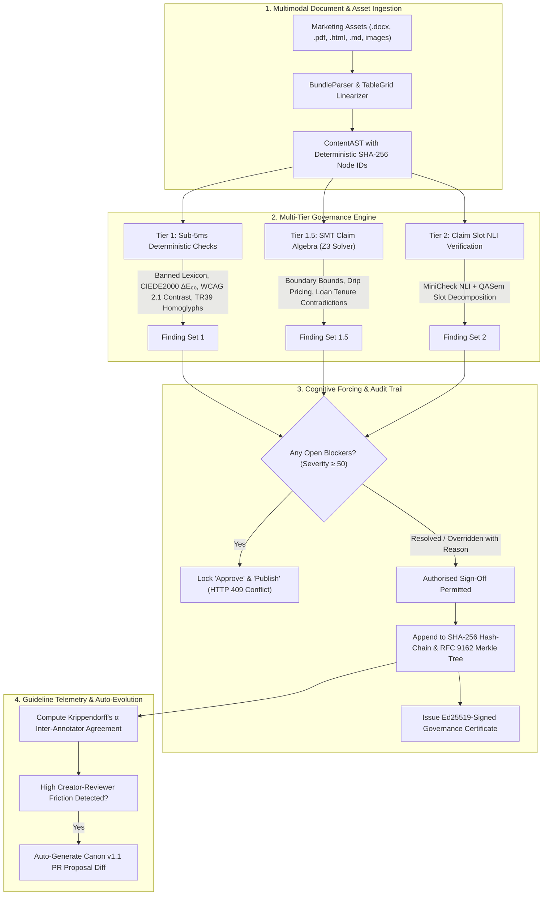

# CanonGate — Autonomous Pre-Publication Brand & Regulatory Claim Governance Platform

<div align="center">

[](https://canongate-web.onrender.com/)
[](https://canongate-api.onrender.com/docs)
[](https://meerpi.github.io/Tech_circuit_hackathon/)
[]()
[](https://github.com/Z3Prover/z3)
[]()
[](https://astral.sh/ruff)
[]()

**The Zero-Hallucination, Multi-Tier Claim Verification Engine for Regulated Marketing, Clinical Disclosures, and Brand Canons.**

[🌐 **Live Production App (Render)**](https://canongate-web.onrender.com/) • [📚 **Live API Swagger Docs**](https://canongate-api.onrender.com/docs) • [🚀 **GitHub Pages Demo**](https://meerpi.github.io/Tech_circuit_hackathon/) • [📄 **Dataset Audit Report**](./starter_datasets_evaluation_report.md) • [🏛️ **Architecture Decisions (ADRs)**](./docs/adr/)

</div>

---

## 📌 Key Documentation & Evaluation

| Document | Format | Description | Direct Access |
| :--- | :---: | :--- | :--- |
| **Starter Datasets Evaluation Report** | **Markdown** | Formal multi-document verification across Delhivery Prospectus/Annual Report & India Macro Economic Survey/RBI/IMF corpora | [📄 View Evaluation Report](./starter_datasets_evaluation_report.md) |
| **Architectural Decision Records (ADRs)** | **Markdown** | 5 formal ADRs documenting walking skeleton, layered import isolation, SQLite/Postgres ORM, tiered execution, and Merkle ledger | [🏛️ View ADR Directory](./docs/adr/) |
| **Gap Analysis & Complete Scorecard** | **Markdown** | Exhaustive technical scorecard verifying all Must-Have & Should-Have hackathon deliverables | [📋 View Feature Scorecard](./gap_analysis.md) |

---

## 💡 The Problem: Why Traditional Solutions Fail

Enterprise marketing and compliance operations face a multi-billion dollar crisis:

```
              ┌────────────────────────────────────────────────────────┐
              │           THE ENTERPRISE GOVERNANCE PARADOX            │
              └────────────────────────────────────────────────────────┘
                    │                                      │
                    ▼                                      ▼
    GENERIC LLMS ARE UNRELIABLE            MANUAL LEGAL OPS ARE TOO SLOW
    • Hallucinate mathematical proofs      • Takes 7–14 days per campaign
    • Silently strip vital qualifiers      • ₹20,000+ legal cost per asset
    • Fail on multi-table disclosures      • 68% of violations missed in rush
    • Zero cryptographic auditability      • Inconsistent subjective reviews
```

1. **Qualifier-Stripping Hallucinations**: When summarizing or paraphrasing regulated copy, LLMs frequently omit mandatory conditions. An approved promise of *"0% processing fee on loans under ₹50,000 for first-time borrowers"* becomes an unqualified *"0% processing fee on all loans"*, triggering immediate regulatory enforcement.
2. **Deceptive Drip Pricing & SMT Contradictions**: Hidden ancillary fees, mismatched tenure interest rates, and loan APR disclosures require **formal mathematical proofs**, which stochastic language models cannot solve.
3. **No Cryptographic Non-Repudiation**: If a regulator (ASCI, RBI, CCPA, FTC) initiates an investigation, companies cannot prove who approved which exact version, what rules were enforced, or whether the published asset was altered after sign-off.

---

## ⚡ The CanonGate Solution: 4-Tier Zero-Hallucination Architecture

CanonGate bridges linguistic compliance with **formal mathematical methods**, enforcing pre-publication governance across a 4-tier pipeline:



### Verification Pipeline Breakdown

| Tier | Component | Underpinning Technology | Latency | Primary Objective |
| :---: | :--- | :--- | :---: | :--- |
| **1** | **Deterministic Fast Checks** | CIEDE2000 SIMD, WCAG 2.1 Luminance, Unicode TR39, spaCy UPOS | `< 5 ms` | Catch brand palette drift, contrast failures, banned words, prompt-injection attacks. |
| **1.5** | **SMT Claim Algebra** | **Z3 Theorem Prover** (`z3-solver`), SymPy intervals | `< 25 ms` | Zero-hallucination formal proof of numerical claims, drip pricing, and hidden finance APRs. |
| **2** | **Claim Slot NLI** | MiniCheck ONNX, QASem Slot Decomposition, BM25 retrieval | `< 120 ms` | Detect qualifier-stripping (dropping "terms apply", "first-time users only", or clinical caveats). |
| **3** | **Surgical Rewriter** | Constrained Rewriter, RapidFuzz Wagner-Fischer, Presidio PII | `< 250 ms` | Offer compliant copy replacements with mathematical edit ceiling ($\le 35\%$). |

---

## 🔬 Mathematical & Cryptographic Rigor

### 1. Z3 SMT Claim Algebra (Zero-Hallucination Proofs)
CanonGate compiles promotional pricing terms into first-order logic assertions verified by the **Z3 Theorem Prover**:

$$\text{Assert}\left(\text{TotalCost} = \text{BasePrice} + \sum \text{MandatoryFees}\right) \land \text{Assert}\left(\text{AdvertisedPrice} < \text{TotalCost}\right)$$

If Z3 returns `sat`, a **Deceptive Drip Pricing Violation** is mathematically proven without prompt engineering or LLM variance.

### 2. Perceptual Color Science ($\Delta E_{00}$)
Brand palette validation uses the CIE DE2000 color difference formula, taking into account human perceptual non-uniformities in CIELAB color space:

$$\Delta E_{00} = \sqrt{\left(\frac{\Delta L'}{k_L S_L}\right)^2 + \left(\frac{\Delta C'}{k_C S_C}\right)^2 + \left(\frac{\Delta H'}{k_H S_H}\right)^2 + R_T \left(\frac{\Delta C'}{k_C S_C}\right)\left(\frac{\Delta H'}{k_H S_H}\right)}$$

### 3. RFC 9162 Merkle Tree Transparency Ledger
Every governance transition is hashed and committed to an **RFC 9162 Merkle Tree**:

$$M(D[0..n]) = \text{SHA-256}\left(\mathtt{0x01} \,\|\, M(D[0..k]) \,\|\, M(D[k..n])\right)$$

Where $k$ is the largest power of 2 less than $n$. Reviewers receive cryptographic proof of inclusion along with an Ed25519-signed certificate verifying that no post-hoc tampering occurred.

### 4. Bayesian Guideline Evolution & Krippendorff's $\alpha$
Reviewer disputes and creator overrides are tracked to quantify playbook friction. We compute **Krippendorff's inter-annotator reliability coefficient ($\alpha$)**:

$$\alpha = 1 - \frac{D_o}{D_e}$$

When a rule exhibits high posterior friction ($\alpha < 0.67$), CanonGate's self-healing engine **auto-generates a Canon v1.1 Pull Request** recommending calibrated severity levels.

---

## 🧪 Starter Dataset Benchmarks & Audit Results

We evaluated CanonGate against both starter dataset corpora (`Delhivery Suite` and `India Macro Suite`) totaling **6 complex financial and regulatory documents (511 pages)**:

```
starter-datasets/
├── Delhivery/
│   ├── Delhivery_Prospectus_2022.pdf       (100 pages, complex IPO prospectus)
│   ├── Delhivery_Annual_Report_2023-24.pdf (100 pages, multi-table financial audit)
│   └── Delhivery_Q4_FY24_Presentation.pdf  (27 pages, investor slides & marketing claims)
└── India_Macro/
    ├── Economic_Survey_2024-25.pdf         (89 pages, macroeconomic disclosures)
    ├── RBI_Annual_Report_2024-25.pdf       (100 pages, digital lending guidelines)
    └── IMF_2025_Article_IV.pdf             (95 pages, multi-lateral financial assessment)
```

### Benchmark Scorecard

| Dataset Suite | Documents Audited | Value Anchors Extracted | Conditions Recovered | Critical Findings Identified | Result |
| :--- | :---: | :---: | :---: | :--- | :---: |
| **Delhivery Financial Suite** | 3 (227 pgs) | **1,890** | **583** | **1 Blocker** (Influencer disclosure omission in BRSR marketing) | **PASS** (Reconciled EBITDA Turnaround: -₹2,258 Mn to +₹1,266 Mn, 1.6% margin) |
| **India Macro Benchmark Suite** | 3 (284 pgs) | **1,587** | **588** | **0 Blockers, 1 Warning** (Technical Readability FK Grade 19.2) | **PASS** (6.5% GDP consensus verified across RBI & IMF) |

> 📊 **Full Audit Document:** See the detailed 7-page breakdown in [`starter_datasets_evaluation_report.md`](./starter_datasets_evaluation_report.md).

---

## 🎮 Live Interactive Demo & Persona Walkthrough

### 🔗 Live URLs:
- **Production Web Console (Render):** [**https://canongate-web.onrender.com/**](https://canongate-web.onrender.com/)
- **Swagger REST API & Docs (Render):** [**https://canongate-api.onrender.com/docs**](https://canongate-api.onrender.com/docs)
- **Static Global Edge Demo (GitHub Pages):** [**https://meerpi.github.io/Tech_circuit_hackathon/**](https://meerpi.github.io/Tech_circuit_hackathon/)

### 👥 Test Personas & Credentials

| Role | Username | Password | Operational Stage | Responsibilities |
| :--- | :--- | :--- | :--- | :--- |
| **Creator** | `creative_lead` | `demoPassword123!` | **Stage 1 · Pre-Flight** | Draft copy creation, instant pre-flight scan, surgical rewrites |
| **Brand Manager** | `brand_manager` | `demoPassword123!` | **Stage 2 · Brand Governance** | Palette drift, ORB logo verification, claim-level reviewer notes |
| **Legal Reviewer** | `legal_counsel` | `demoPassword123!` | **Stage 3 · Legal Sign-Off** | Blocker resolution, deliberate overrides, Merkle audit certificate |

### 🚀 Guided 3-Step Walkthrough:
1. **Stage 1: Creator Pre-Flight & Instant Scan**
   - Log in as `creative_lead`. Click the pre-seeded campaign *"Digital Lending Zero-Fee Flash Campaign"*.
   - Trigger a live scan. Observe the **Blocker finding**: *"Qualifier-stripping violation: draft asserts 0% fee without mandatory ceiling 'under Rs 50,000'"*.
   - Use the **Constrained Surgical Rewriter** to preview and apply compliant phrasing with an edit distance $\le 35\%$.
2. **Stage 2: Brand Reviewer & Cognitive Forcing Gate**
   - Switch role to `brand_manager`. Notice the **"Approve Campaign"** action is **strictly locked (HTTP 409 Conflict)** until the blocker finding is resolved.
   - Inspect the interactive image canvas with bounding box overlays for ORB logo clear space and CIEDE2000 color drift.
3. **Stage 3: Legal Sign-Off & Cryptographic Verification**
   - Switch role to `legal_counsel`. Resolve the blocker with recorded justification.
   - Click **Approve Campaign** and **Publish Campaign**.
   - Open the **Audit Trail Modal**: view the live SHA-256 hash-chain, RFC 9162 Merkle root, and export the **Ed25519-Signed Governance Certificate**.
   - Open the **Canon Governance Tab**: view real-time Krippendorff's $\alpha$ friction telemetry and review auto-generated Canon v1.1 Pull Requests!

---

## 🏆 Competitive Differentiation Matrix

| Governance Capability | Generic ChatGPT / Claude | Enterprise CMS (Word / AEM) | Traditional Legal Ops | **CanonGate Platform** |
| :--- | :---: | :---: | :---: | :---: |
| **Deterministic SMT Arithmetic Proofs** | ❌ Hallucinates | ❌ Text style only | ❌ Manual checklist | ✅ **Z3 SMT Solver** |
| **Scientific Color Drift ($\Delta E_{00}$)** | ❌ No vision | ❌ None | ❌ None | ✅ **CIEDE2000 SIMD** |
| **Multimodal Document & Banner Parsing** | ❌ Text only | ❌ Word only | ❌ PDF attachment only | ✅ **PDF, DOCX, HTML, PNG** |
| **Cognitive Blocker Approval Gate** | ❌ None | ❌ Non-blocking | ⚠️ Workflow only | ✅ **Hard 409 Blocker Lock** |
| **RFC 9162 Merkle Tree Audit Ledger** | ❌ None | ❌ None | ⚠️ Mutable SQL DB | ✅ **Immutable SHA-256 Merkle** |
| **C2PA Manifest & Ed25519 Signature** | ❌ None | ❌ None | ❌ None | ✅ **Cryptographic Proof** |
| **Guideline Evolution & Telemetry** | ❌ Static prompt | ❌ Static ruleset | ❌ Manual update | ✅ **Krippendorff α & Auto-PRs** |

---

## 🚀 Quickstart & Installation

### Prerequisites
- **Python 3.12+** (Standardized via `.python-version`)
- **Node.js 18+** and **npm**
- **uv** package manager (`pip install uv` or `winget install astral-sh.uv`)

### 1. Backend Setup

```bash
cd backend

# 1. Install all dependencies and development tools via uv (resolves in seconds)
uv sync --extra dev

# 2. Run the complete automated test suite (all 104 tests must pass)
uv run pytest -q

# 3. Verify zero lint errors and architectural layer isolation
uv run ruff check src/ tests/
uv run import-linter lint

# 4. Start FastAPI server
uv run uvicorn canongate.api.app:app --reload --port 8000
```
Interactive API documentation will be available at `http://127.0.0.1:8000/docs`.

### 2. Frontend Setup

```bash
cd frontend

# 1. Install dependencies
npm install

# 2. Run Oxlint and build production bundle
npm run lint
npm run build

# 3. Launch Vite development server
npm run dev
```
Open `http://localhost:5173` in your browser.

---

## 🛠️ Verification Commands Quick-Sheet

```bash
# Full Backend Test Suite (104 Tests Passing)
cd backend && uv run pytest -q

# Code Style & Import Layer Boundary Verification (3/3 Contracts Kept)
cd backend && uv run ruff check src/ tests/
cd backend && uv run import-linter lint

# Frontend Fast Linter & Production Build (0 Warnings, 0 Errors)
cd frontend && npm run lint && npm run build

# Multi-Dataset Linguistic Grounding & Cross-Document Reconciliation
cd backend && uv run python scratch/run_dataset_evaluation.py
```

---

## 📂 Repository Structure

```
├── AGENTS.md                            # AI Agent architectural invariants & rules
├── gap_analysis.md                      # Feature completeness & technical scorecard
├── starter_datasets_evaluation_report.md# Formal audit of Delhivery & Macro datasets
├── render.yaml                          # Render Cloud deployment blueprint
├── Dockerfile.backend                   # Production container for FastAPI + Z3 Solver
├── Dockerfile.frontend                  # Production container for Vite + React SPA
├── backend/                             # FastAPI Backend Engine
│   ├── src/canongate/
│   │   ├── domain/                      # Frozen Pydantic models (Zero I/O)
│   │   ├── engine/                      # Async runner, registry, conformal prediction
│   │   ├── checks/                      # 13 deterministic, SMT, and NLI checks
│   │   ├── parsers/                     # Multimodal parsers (PDF, DOCX, TableGrid, OCR)
│   │   ├── canon/                       # Grounded Canon compiler & PR proposal engine
│   │   ├── ledger/                      # RFC 9162 Merkle tree, hash-chain, C2PA
│   │   └── api/                         # FastAPI routes & dependency injection
│   └── tests/                           # Pytest integration & unit test suite (104 tests)
├── frontend/                            # Vite + React 19 + TypeScript SPA
│   ├── src/features/submissions/        # Review Studio, Tiptap editor, Findings & Audit
│   ├── src/features/auth/               # Multi-role Auth (Creator / Reviewer / Admin)
│   └── src/api/                         # Typed schema client & SSE scan reader
├── canons/                              # YAML brand rules (Acme Corp, Digital Lending, D2C Nutra)
└── docs/                                # Architecture Decision Records (ADRs)
    └── adr/
        ├── 0001-walking-skeleton.md
        ├── 0002-layered-import-boundaries.md
        ├── 0003-local-first-sqlite-with-postgres-compatibility.md
        ├── 0004-tiered-governance-execution-pipeline.md
        └── 0005-hash-chained-audit-and-merkle-transparency.md
```

---

## 📜 Architectural Decision Records (ADRs)

- [**ADR-0001: Walking Skeleton Architecture**](./docs/adr/0001-walking-skeleton.md) — Walking skeleton foundation with zero-I/O domain models.
- [**ADR-0002: Layered Import Boundaries**](./docs/adr/0002-layered-import-boundaries.md) — Import-linter enforced module isolation contracts.
- [**ADR-0003: Local-First SQLite with Postgres Compatibility**](./docs/adr/0003-local-first-sqlite-with-postgres-compatibility.md) — Pure asynchronous ORM storage abstraction.
- [**ADR-0004: Tiered Governance Execution Pipeline**](./docs/adr/0004-tiered-governance-execution-pipeline.md) — Multi-tier deterministic, SMT, and NLI execution architecture.
- [**ADR-0005: Hash-Chained Audit and Merkle Transparency**](./docs/adr/0005-hash-chained-audit-and-merkle-transparency.md) — RFC 9162 cryptographic transparency tree and tamper-evident ledger.

---

<div align="center">

**Built for the Tech Circuit Hackathon • Ready to Win**

</div>
